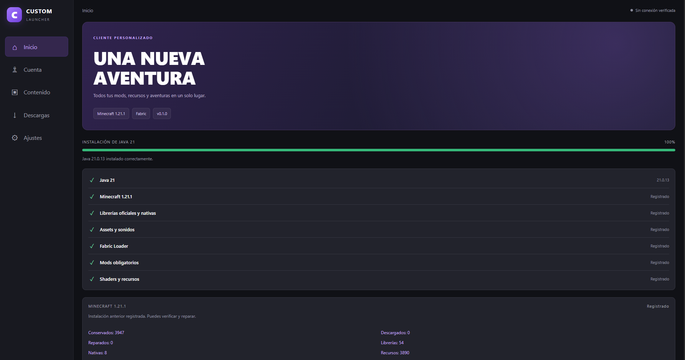
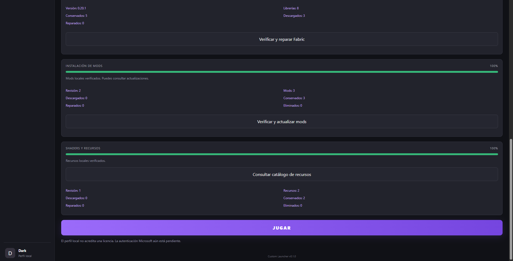
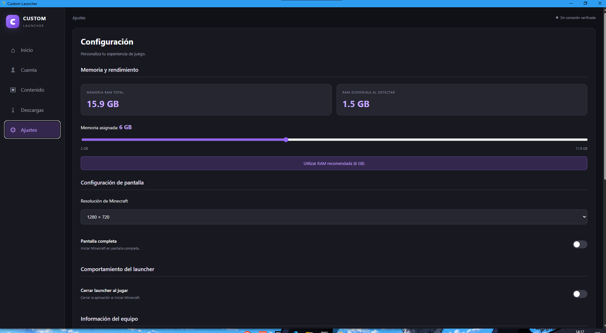
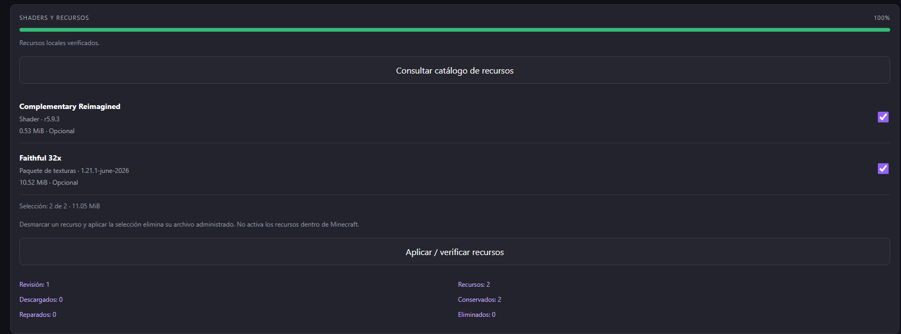

# Custom Launcher

Independent Windows desktop launcher for Minecraft: Java Edition. Currently under development.

## Project overview

Custom Launcher aims to simplify installation and maintenance of a Fabric-based Minecraft environment for a dedicated multiplayer community.

## Current development status

- Windows x64 desktop application built with Tauri 2, Rust and React.
- Java 21 runtime management.
- Minecraft 1.21.1 and Fabric installation.
- Manifest-based updates for mods, shaders and resource packs.
- Launch preparation, process management and diagnostic logging implemented; actual authenticated game launch remains untested.
- Microsoft account authentication, license verification and server integration are planned or under development.

## Authentication

The planned authentication flow uses the official Microsoft browser sign-in page with OAuth 2.0 authorization code flow and PKCE. The launcher will not request Microsoft passwords directly. Minecraft services access is requested to verify entitlement, obtain the authenticated game profile and establish a valid game session. Local profiles do not establish game ownership and game execution is currently blocked without authenticated sessions.

## Repository purpose

This repository hosts content manifests and update assets for Custom Launcher. It is not represented as the complete launcher source code or a finished public release.

## Privacy and independent status

- [Privacy notice](PRIVACY.md)
- [Disclaimer](DISCLAIMER.md)

This project is independent and is not an official Minecraft product. It is not approved by or associated with Mojang or Microsoft.

## Application screenshots

The following screenshots show the current development version of Custom Launcher.

### Home and installation status

### Game installation and launch controls

### Memory and display settings

### Shaders and resource packs

## Development notice

The launcher is currently under active development.
Microsoft account authentication is pending implementation
and Minecraft API authorization.

